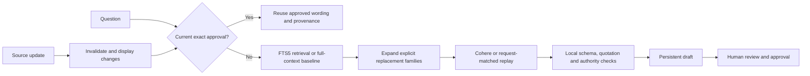

# Questionnaire Evidence & Review

Assignment C: a local workspace for grounded questionnaire drafts, human review,
approved-answer reuse, and visible source-change invalidation.

The supplied fictional rules and original seeds remain unchanged under
`client-ai-starter-pack/tasks/evidence/`. The working questionnaire adds one question
that requires both billing and support evidence. Only Assignment C is implemented.

## Run without an API key

On macOS, Linux, or Windows through WSL, run:

```bash
./full_run.sh
```

The launcher finds the pinned uv version or installs it under `.runtime/`, obtains Python
3.12.15, creates `.venv`, installs the locked packages, runs lint/tests/replay verification,
and starts the app. No manual environment activation or API key is required. Initial setup
needs Internet and `curl` or `wget`; no sudo, shell-profile change, or environment-file overwrite
is performed. An existing environment is reused. Checks must pass before the server starts.

Use `./full_run.sh --check-only` to set up and verify without starting a server,
`./full_run.sh --port 8502` if port 8501 is already occupied, or `--bootstrap` to force
project-local uv. The launcher covers the native local pipeline; security auditing, container
recreation, and delivery packaging remain additional CI checks.

If you prefer manual setup, install [uv](https://docs.astral.sh/uv/getting-started/installation/),
then run from the repository:

```bash
uv sync --locked
uv run streamlit run app.py
```

Open http://127.0.0.1:8501. **Saved real responses** and **Retrieve relevant evidence**
are the defaults. Click **Draft pending questions**, select a question, and inspect its
answer, evidence, and history. Replay performs no provider calls and needs no credentials.
Python 3.12.15 and dependency versions are pinned; uv can install the isolated runtime.

For container delivery, install Docker with Compose and run:

```bash
docker compose up --build
```

The host port is bound to localhost. State is kept in the named `review-state` volume.
`docker compose down` preserves that volume; adding `--volumes` deliberately deletes it.
Container execution is verified by CI, including recreation with the same approval state.

## Verify

```bash
uv run pytest
uv run python scripts/verify.py
uv run ruff check .
uv run ruff format --check .
```

`verify.py` regenerates [expected-versus-observed results](reports/verification.md) and a
structured report without live calls. Expectations were specified from the source passages
before evaluating the application. Source inspection is labelled **coding-assistant inspection**,
not automatic semantic proof or human approval. Scripted approval acknowledgements in tests
and container probes are labelled simulations. A person must inspect claims before approving
them in the workspace.

## Review workflow

The evidence card explains source versions, citations, replacement history, and why review
is necessary. Supporting quotations and references are checked automatically; meaning is
checked by the reviewer. The queue distinguishes pending, draft, unresolved, approved,
needs-review, and processing-error states. Approved counts are a subset of answered counts.

Edit wording and supporting quotations, then save a revision. Check the semantic-review box
and approve the exact saved revision. Repeating the exact question and topic returns the
approved wording with **zero model calls**. An unapproved edit cannot replace that wording.
Review confirmation resets when the revision or source snapshot changes. Approval also
checks the expected source snapshot inside a transaction, preventing a stale screen from
approving changed evidence.

Import one of `fixtures/scenarios/*.json` through **Import source update** to demonstrate
freshness. The app retains the before/after change, including uncited changed documents.
The five minimum checks are demonstrated in [the walkthrough](docs/walkthrough.md).

## Architecture



`evidence_review` separates domain rules, storage, retrieval, provider integration, and
workflow. Streamlit is the interface. SQLite stores immutable source snapshots, revisions,
approvals, change records, model runs, and attempt budgets. Connections are short-lived,
SQL is parameterized, foreign keys are enabled, and network requests occur outside transactions.
The default rollback journal is retained; no shared global database connection is used.

FTS5 uses Porter tokenization, ranked lexical matches, and a configurable top-k of three.
Search results expand to their explicit replacement families so retrieving an old passage
also includes its replacement. No lexical hits trigger a labelled full-context fallback;
search failure never proves a feature is absent. There are no embeddings or vector service.

## Model configuration and live mode

The final application uses **Cohere `command-a-03-2025`**, temperature `0`, maximum output
`1,000` tokens, no streaming, and JSON-object output with strict local Pydantic validation.
Prompts and the JSON contract are versioned under `prompts/`; configuration is in
`app-config.toml`. Instructions are separate from question/document data. The model has
no execution tools, approval permissions, or database-writing interface.

Copy the environment example and set only your own key in the ignored `.env`:

```bash
cp .env.example .env
```

Set `MODEL_API_KEY` locally, then choose **Live Cohere**. Never commit the key. Compose passes
the key at runtime; it is excluded from the image. `APP_STATE_DIR` optionally selects the
local state directory. A valid key and permitted model access are required for new live inputs.

Live capture is an explicit operation:

```bash
uv run python scripts/capture_live.py --strategy retrieval --missing-only
```

Each real HTTP attempt counts toward a persisted **50-attempt budget** and **10 attempts
per minute** per local database. One live request runs at a time in the application process.
The provider operation has a 30-second deadline including at most two transient retries.
Authentication, rejected inputs, and malformed model output are not silently retried.
Provider failures remain processing errors; they do not become unknown product capabilities.

Real responses are immutable files matched to exact request fingerprints, including model,
prompt, evidence, and output settings. Changed requests require new recordings. Replay never
silently falls back to live access. Token usage from replay is historical; new provider usage
is zero. Failed calls with unavailable usage remain unknown. Original successful responses,
rejected preflights, and [provider failures](docs/provider-checks.json) are retained.

The initial Command A+ response emitted reasoning outside JSON. Native schema decoding also
produced intermittent failures. The active configuration was selected after observing and
checking those failures. The requested Command A+ pilot is on the separate
`experiment/cohere-command-a-plus` branch and draft PR #3; it is not the final configuration.

## Evidence and freshness rules

Only the fictional supplied evidence establishes product facts. Undocumented means unknown;
an explicitly documented negative can support a No answer. Topic owners come from the supplied
mapping. Dates never establish replacement authority. Historical disagreement resolved by
explicit replacement can support approval; unresolved contradictory evidence cannot.

| Change | Approval handling |
| --- | --- |
| Version only | Review approvals citing that document |
| Added, removed, or text-modified source | Review all existing approvals |
| Replacement or authority-status metadata | Revalidate authority and review all existing approvals |
| Date only | Preserve approval; do not infer authority from date |

These conservative rules are application safeguards, not invented product policies.
Authority metadata ambiguity blocks supported approval until corrected. Changed evidence
is displayed even if it was not cited originally. Reapproval needs fresh semantic review
and acknowledgement of changes. A reviewer can also explicitly leave a question unresolved
with a note, which prevents an existing approval from being reused unchanged.

## Recorded comparison

Nine real questions were checked under each strategy. All 18 selected recordings match the
expected states and references and received independent coding-assistant source inspection.
Mean input tokens were **1,570 with retrieval versus 1,789 with full context**, about **12.2% less**.
Recorded median successful-call latency was about **2.48 s versus 1.98 s**: retrieval was not
faster in this small sample. Provider caching, timing, and exclusion of failed calls prevent
general performance conclusions. This is a demonstration, not a production benchmark.

## Git, CI, and delivery

Development uses real feature commits, pushes, and PRs. PR #1 covers evidence/storage;
PR #2 covers Cohere, real replay, and the comparison; the review/delivery PR completes the app.
PR #3 preserves the alternate-model pilot as an unmerged experiment. Reviews are author
reviews; no independent peer approval is claimed.

CI installs the lockfile, runs Ruff and tests, reproduces the keyless verification, audits
dependencies, and scans Git history with Gitleaks. Actions and container bases are pinned.
No model credential is passed to CI. Container checks exercise replay, health, a fake
build-context credential, and approval persistence across container recreation.

After passing main checks, delivery packages a tracked-file allowlist and verifies replay
from the extracted package. Artifacts are named with their commit SHA and retained seven days.
The CI-produced `delivery-manifest.json` identifies the source commit and producing CI run.
The private repository remains the durable submission. This is automated local package
delivery; cloud deployment is not claimed.

GitHub returned HTTP 403 for private branch protection on the current account. Merges are
manually gated on successful CI and the reviewed head SHA; the repository remains private.

## Limits and handoff

This is one local workspace, not an authenticated multi-tenant service. Reviewer labels are
unverified, the activity history is not tamper-proof, and local file permissions are not
encryption. Citation checks cannot prove semantic entailment. Lexical retrieval may miss
synonyms or unrelated contradictions; conservative invalidation and human inspection help,
but do not establish complete safety. No workload or general model-accuracy claim is made.

Hosted operation would require verified identities and authorization, shared transactional
storage, managed secrets, backups, deployment controls, monitoring, and workload tests.
FastAPI/PostgreSQL and queued generation are future options when required. MCP, fine-tuning,
vector services, Databricks, and AWS deployment are not implemented.

See [security checks](docs/security.md), [AI usage](ai-workflow/README.md), and
[actual work time](docs/time-log.md). Earlier preparation was not instrumented and is reported
separately; it is not represented as zero. Arrange reviewer access to this private repository
before sending the submission. No recruiter messages are sent by the application.
